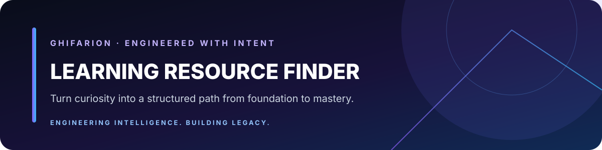

<div align="center">



</div>

# Learning Resource Finder

Skill untuk menyusun learning path empat tahap dari sumber yang bisa diverifikasi: YouTube, PDF, artikel, dan dokumentasi resmi.

> **Ghifarion** · Engineering Intelligence. Building Legacy.

<p align="center">
  
  
  
</p>

## On this page

- [Fitur utama](#-fitur-utama)
- [Struktur repositori](#-struktur-repositori)
- [Cara penggunaan](#-cara-penggunaan)
- [Contoh output](#-contoh-output-learning-path)

---

## 📌 Fitur Utama

- 🧭 **4 Tahap Belajar Terstruktur**:
  1. **Foundation** — Konsep dasar & prasyarat mutlak.
  2. **Core** — Kemampuan inti yang digunakan sehari-hari.
  3. **Advanced** — Topik lanjutan & *best practices*.
  4. **Mastery** — Arsitektur tingkat tinggi & tren terbaru.
- 🎯 **Prioritas Sumber Ketat**:
  - 🎥 **YouTube** (Prioritas Utama)
  - 📄 **PDF** (Validasi URL wajib berakhiran `.pdf`)
  - 📰 **Artikel & Dokumentasi Resmi**
- 🔍 **Hasil Pencarian Nyata**: Tidak ada link atau sumber buatan; semua dikurasi secara langsung.

---

## 📁 Struktur Repositori

```tree
.
├── learning-resource-finder/
│   └── SKILL.md            # Definisi & panduan alur kerja skill
└── README.md               # Dokumentasi utama repositori
```

---

## 🚀 Cara Penggunaan

Gunakan skill ini ketika memerlukan panduan belajar terstruktur untuk topik tertentu:

```markdown
"Cariin resource belajar untuk Data Analyst"
"Buatkan learning path untuk Backend Developer"
"Roadmap belajar Python dari dasar sampai mahir"
```

---

## 📋 Contoh Output Learning Path

```markdown
## Foundation
### YouTube
- [Konsep Dasar Data Analysis](https://youtube.com/...)

### PDF
- [Pengantar Statistik.pdf](https://example.com/stat.pdf)

### Artikel
- [Dokumentasi Resmi Python](https://docs.python.org/3/)
```

---

<p align="center">
  <sub>Dibuat dengan ❤️ untuk pembelajaran terstruktur dan efektif.</sub>
</p>
